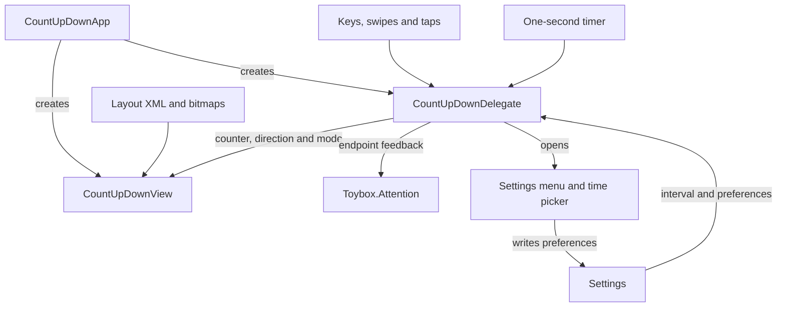
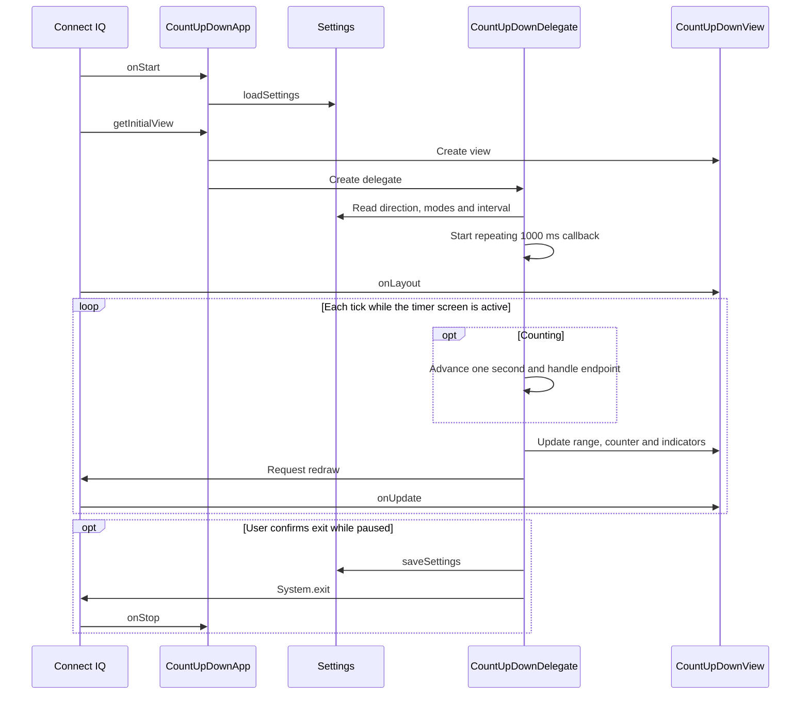

# CountUpDown

CountUpDown is a Garmin Connect IQ watch app for timing an interval in either direction. Use it for a single countdown, a repeating interval that resets, or a timer that counts down and then back up. The watch can vibrate at each endpoint and, on models with tone support, beep as well.

[Using the watch](#using-the-watch) · [Timer behavior](#timer-behavior) · [Application design](#application-design) · [Build-and-test guide](#build-and-test-guide)

## Using the watch

### Try a 30-second countdown

1. Open **CountUpDown** from the watch's apps. It launches paused.
2. Open the app's **Settings** using the watch's Menu action. Choose **Count Interval**, set **Target Time** to `00:30`, and confirm the picker.
3. Set **Count Direction** to **Count Down** and **Count Repet** to **One Time**. Turn **Vibrate** on if you want a tactile alert. **Beep** appears on watches that support tones.
4. Press **Back** from Settings. The timer immediately shows `00:30` and starts counting down. Confirming or canceling the interval picker first returns you to Settings, where you can finish choosing the other options.
5. Tap the main screen or press **Select/Enter** to pause or resume at the current value. At `00:00`, the enabled alerts fire and the counter stops.

### Controls on the main screen

| Action | Button or gesture | What happens |
| --- | --- | --- |
| Start, pause, or resume | Select/Enter or tap | Toggles counting and keeps the current value. |
| Switch to counting up | Up button or swipe up | If currently set to Down, switches to Up and starts counting from the current value. |
| Switch to counting down | Down button or swipe down | If currently set to Up, switches to Down and starts counting from the current value. |
| Configure the timer | Device Menu action | Pauses counting while Settings is open. Leaving Settings starts a fresh interval, even if you entered paused or made no changes. |
| Save and exit | Back/Esc while paused, then **Yes** | Saves the timer configuration and closes the app. **No** keeps the session open. Back/Esc while running is consumed by the timer. |

Selecting a direction that is already active leaves the running/paused state alone. To resume a paused timer in the same direction, use Select or tap. In the Garmin simulator's device profiles, the Menu action is a hold on **Up/Menu** on fēnix 7 Pro, the **lower right button** on Venu Sq, and the **upper right button** on Venu Sq 2.

### Reading the display

```text
              14:08:52           watch clock
            From: 30 to: 0       range in seconds
                00:17            current counter in minutes:seconds
              Count Down         direction or Paused
        [↓] [reset] [1]  [vibrate]
```

This sketch shows the rectangular Venu Sq layout. The clock and range are blue, and the large timer is yellow. Below the direction text, read the icons from left to right: direction, reset/mirrored mode, repetition, then alert settings. On the round fēnix targets, direction and repetition flank the status text; the lower row shows the speaker, reset/mirror symbol, and vibration indicator.

A red slash means that alert is switched off in the app. The speaker appears only on devices that support tones; the Venu Sq and Sq 2 show just the vibration indicator for alerts.

### Settings

| Menu label | Choices | Effect |
| --- | --- | --- |
| **Count Interval** | `00:00`–`59:59` | Pick minutes and seconds. Confirm to store the target in seconds, or cancel to keep the previous value. |
| **Count Direction** | Count Up / Count Down | When you leave Settings, Up starts at zero and counts to the interval. Down starts at the interval and counts to zero. |
| **Count Type** | Reset / Mirrored | In repeated mode, either jump back to the starting endpoint or reverse direction at the endpoint just reached. |
| **Count Repet** | One Time / Repeated | Stop after one endpoint or keep running. In One Time mode, Count Type has no effect. |
| **Beep** | On / Off | Enables an endpoint tone. The menu shows this toggle only when `Attention has :playTone`. Both Venu Sq targets omit it. |
| **Vibrate** | On / Off | Enables the endpoint vibration pattern on watches that support vibration. Independent of Beep. |

Beep and Vibrate default to **On**. For a silent timer on a tone-capable watch, turn both off. On a Venu Sq or Venu Sq 2, turning Vibrate off silences the endpoint alert.

## Timer behavior

Up counts toward the configured interval. Down counts toward zero. Each running tick advances the counter by one second and checks the endpoint **on that same tick**. Pausing freezes the counter while the watch clock continues to update.

| At the endpoint | One Time | Repeated + Reset | Repeated + Mirrored |
| --- | --- | --- | --- |
| Up reaches the target | Alert and pause at target | Alert and reset to zero | Alert and start counting down from target |
| Down reaches zero | Alert and pause at zero | Alert and reload the target | Alert and start counting up from zero |

Here is the **displayed counter in seconds** for three timers that all start counting down from three. The chart shows why zero can appear to be skipped in Reset mode: the counter reaches zero, alerts, and reloads three before the screen redraws.

| Seconds since start | 0 | 1 | 2 | 3 | 4 | 5 | 6 |
| --- | ---: | ---: | ---: | ---: | ---: | ---: | ---: |
| One Time | 3 | 2 | 1 | **0** | 0 | 0 | 0 |
| Repeated + Reset | 3 | 2 | 1 | **3** | 2 | 1 | **3** |
| Repeated + Mirrored | 3 | 2 | 1 | **0** | 1 | 2 | **3** |

**Bold** marks an endpoint event. At the upper endpoint the app requests `TONE_TIME_ALERT` and two 200 ms vibration pulses separated by 400 ms. At zero it requests `TONE_INTERVAL_ALERT` and one 500 ms pulse. Each output is gated by its own preference and device capability.

### Starting values and edge cases

- On launch, the delegate initializes the counter to the saved interval **in either direction**. A freshly launched Count Up session therefore starts at its upper endpoint. Its first running tick performs the selected endpoint action. To count up from zero in a one-time session, finish a countdown and then press Up or swipe up.
- After a one-time timer finishes, Select resumes from that same endpoint. Switch direction to travel back through the interval, or reopen the app to reload the saved interval.
- To restart from the selected direction's starting value at any time, open Settings and press Back. The timer uses the interval, direction, repetition, and count type selected in the menu.
- A zero interval is accepted. In repeated mode both endpoints are zero, so the app can request an alert every running tick. Use at least one second to space out alerts.

## Application design

The [manifest](manifest.xml) registers `CountUpDownApp` as a foreground watch app with minimum Connect IQ API **3.0.0**. Its entry point returns a view and a behavior delegate. The delegate owns timekeeping, input, and endpoint decisions. The view renders the values that the delegate supplies.



### Launch, redraw, and exit



The app advances an integer once per timer callback. It does not record a start timestamp or restore elapsed time across launches. On redraw, the view reads the watch clock separately, formats the counter as `MM:SS`, draws the layout labels, then overlays the selected icons.

### What survives a restart?

| Data | Where it lives | When it is saved or restored |
| --- | --- | --- |
| Interval, direction, repetition, count type | Application properties during use, plus an application storage snapshot | **Confirm Exit → Yes** copies the four properties to storage. `onStart()` loads that snapshot back into properties. Mirrored counting updates the direction as it runs, so the saved direction may differ from the initial choice. |
| Beep and Vibrate | Application properties `beepEnabled` and `vibrateEnabled` | Written when toggled. These values are independent of the four-field exit snapshot. |
| Counter value and running/paused flag | Delegate memory | A new session starts paused with the configured interval as its counter. |

The [property resource](resources/properties/properties.xml) declares 30 seconds, Count Up, Repeated, and Reset. The startup path also reads storage on a fresh install. When values are absent, [Settings](source/Settings.mc) has getter fallbacks of 60 seconds, Count Down, One Time, and Reset. To reproduce a particular session, select the four settings explicitly and confirm exit before relaunching.

### Source map

| File | Responsibility |
| --- | --- |
| [monkey.jungle](monkey.jungle) and [manifest.xml](manifest.xml) | SDK project entry, app class, supported products, language, and permissions. |
| [CountUpDownApp.mc](source/CountUpDownApp.mc) | Lifecycle hooks, initial view/delegate construction, and accessors shared by the screens. |
| [CountUpDownDelegate.mc](source/CountUpDownDelegate.mc) | One-second timer, input mapping, state transitions, endpoint alerts, settings menu construction, and exit flow. |
| [CountUpDownView.mc](source/CountUpDownView.mc) | Drawable lookup, clock and counter formatting, device-shape layout, and bitmap rendering. |
| [Settings.mc](source/Settings.mc) | Typed property keys in the resource file are read and written here. Also manages the exit snapshot. |
| [SettingsMenuDelegate.mc](source/SettingsMenu/SettingsMenuDelegate.mc) | Dispatches menu selections, writes toggles, and restarts the timer with the final settings when the menu closes. |
| [TimePicker.mc](source/SettingsMenu/TimePicker.mc) | Two numeric picker columns, a separator, and accept/cancel handling. Converts the selection to seconds. |
| [ConfirmationDialogDelegate.mc](source/ConfirmationDialog/ConfirmationDialogDelegate.mc) | Forwards the exit dialog response to the timer delegate. |
| [Utils.mc](source/Utils.mc) | Debug logging with optional line termination through separate methods. Release builds use empty implementations. |
| [Layout](resources/layouts/layout.xml), [bitmap definitions](resources/resources.xml), [strings](resources/strings/strings.xml) | Main-screen text elements, icon resource IDs, and shared UI text. |

## Build-and-test guide

### Supported targets

| Watch | SDK product ID | Useful check |
| --- | --- | --- |
| fēnix 7 | `fenix7` | Round layout and button input |
| fēnix 7 Pro | `fenix7pro` | Beep toggle and both endpoint tones |
| fēnix 7 Pro (no Wi-Fi) | `fenix7pronowifi` | Model-specific build |
| fēnix 7S | `fenix7s` | Smaller round layout |
| Venu Sq | `venusq` | Rectangular layout, touch input, vibration |
| Venu Sq 2 | `venusq2` | Status text above the icon row, vibration, Beep hidden |

### Run in the simulator or on a watch

1. Install Garmin's Connect IQ SDK Manager, an SDK, the target's device profile, and the Monkey C extension for VS Code. Configure a developer signing key and run **Monkey C: Verify Installation**. [Garmin setup guide](https://developer.garmin.com/connect-iq/connect-iq-basics/getting-started/)
2. Open the folder containing `monkey.jungle`, open a Monkey C source file, and use **Run → Start Debugging**. Choose a product ID from the table. For layout and capability testing, try both `venusq2` and `fenix7pro`. [Monkey C extension guide](https://developer.garmin.com/connect-iq/reference-guides/visual-studio-code-extension/)
3. For a physical watch, use **Monkey C: Build for Device**, choose the matching product, and copy the resulting `.prg` to the watch's `GARMIN/APPS` directory. Disconnect the device and open CountUpDown from its apps. [Garmin sideloading instructions](https://developer.garmin.com/connect-iq/connect-iq-basics/your-first-app/)

For a command-line debug build, run this from the repository root with the SDK's `bin` directory on your `PATH`. Set `GARMIN_DEVELOPER_KEY` to the path of your DER signing key. Start the Connect IQ simulator before running `monkeydo`.

```sh
mkdir -p build/venusq2
monkeyc -f monkey.jungle -d venusq2 -y "$GARMIN_DEVELOPER_KEY" -o build/venusq2/CountUpDown.prg
monkeydo build/venusq2/CountUpDown.prg venusq2
```

Add `-r` to `monkeyc` for a release build. In debug builds, `Utils.log(message)` prints a line and `Utils.logWithNewline(message, false)` prints a fragment. Release builds skip the print operations. Expressions passed as log arguments can still incur work, including string construction inside the one-second callback.

### Manual checks

The repository has no automated timer test suite. Set the interval to three seconds and press Back from Settings to start each run.

| Check | Action | Expected result |
| --- | --- | --- |
| Pause and resume | Start a countdown, pause at two, wait, then resume | The counter holds at two while the clock advances; the next running tick shows one. |
| Restart from Settings | Try both directions with a three-second interval. Wait in the picker before returning to Settings and pressing Back. | Counting starts on menu exit. Down shows three then two; Up shows zero then one. |
| Endpoints and modes | Try each row of the three-second chart above | The displayed values and endpoint alerts follow that row. |
| Direction change | During a longer countdown, switch to Up | The next tick increments the existing counter. |
| Independent alerts | On a tone-capable watch, try Beep only, Vibrate only, both, and neither | Each enabled output fires at the endpoint. Use a physical watch to check audible and tactile behavior. |
| Device-specific UI | Compare Settings and the main screen on Venu Sq 2 and fēnix 7 Pro | Venu Sq 2 omits Beep and places icons below the status text. fēnix 7 Pro offers Beep and uses the round layout. |
| Persistence and exit | Pause, decline exit, then confirm exit and relaunch | Declining keeps the session. After confirmed exit the chosen configuration returns and the counter starts paused at the interval. |

### References

The original project references Garmin SDK samples **Attention**, **ConfirmationDialog**, **MenuTest**, **Menu2Sample**, **Picker**, and **Timer**, and [V. Budnyi's videos](https://www.youtube.com/@vbudnyi).
